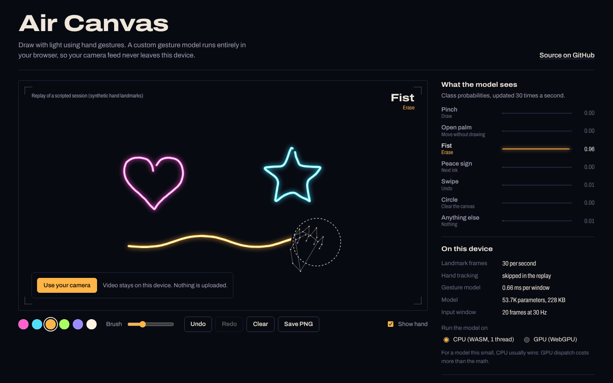
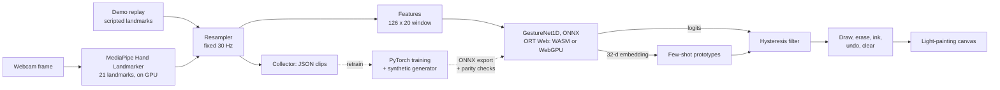
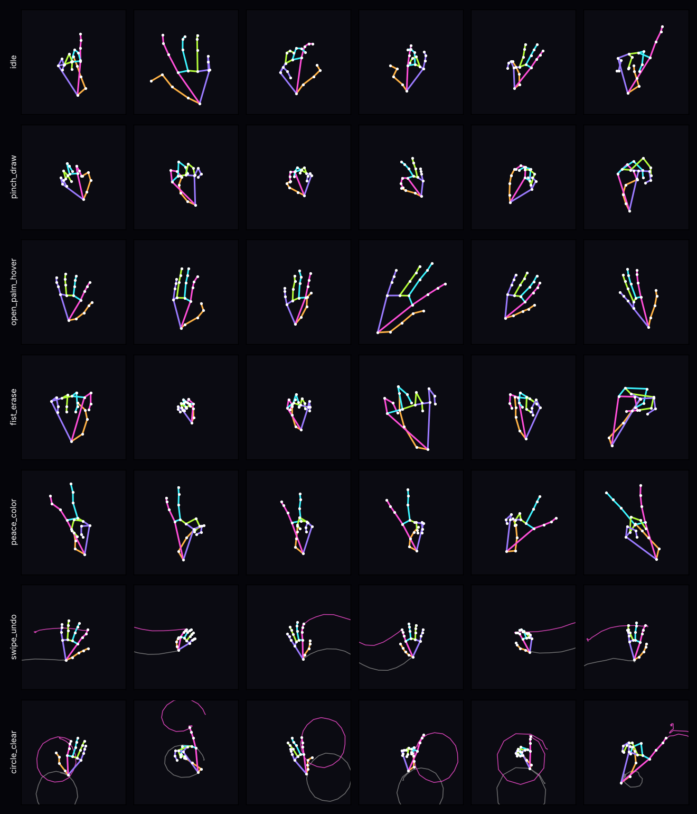
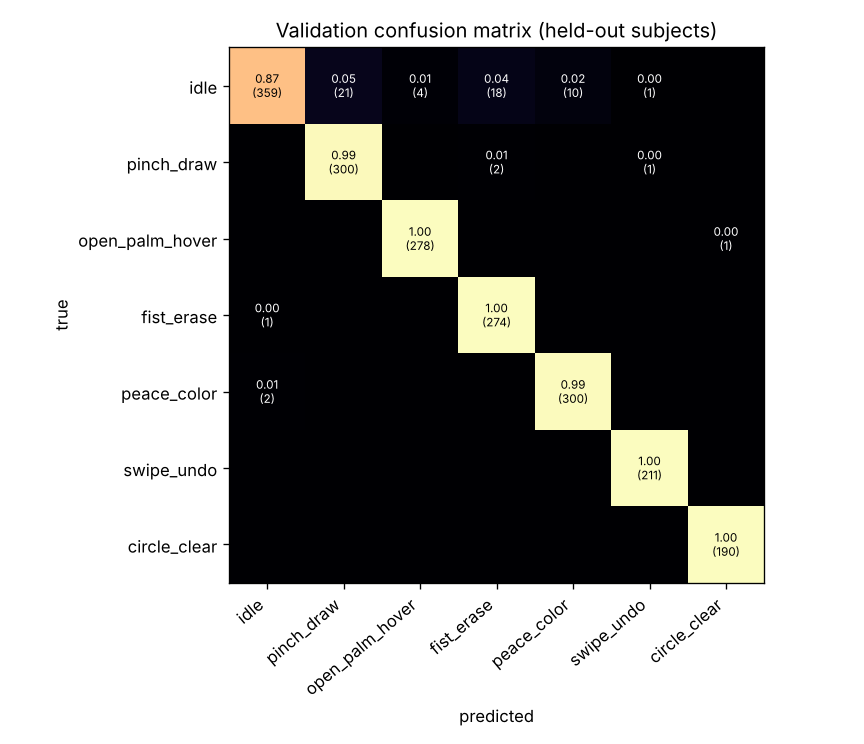

# Air Canvas

Draw glowing strokes in mid-air using hand gestures!
A custom gesture model trained in PyTorch and exported to ONNX running entirely in the browser. 
Privacy Note: There is no server and the camera feed can be seen by you only.

**Live demo: https://yjjr0.github.io/air-canvas-ml/**.
You can see the model working in the live demo before granting camera access.



| Gesture | Action |
| --- | --- |
| Pinch (thumb + index tips) | Draw |
| Open palm | Move the cursor without drawing |
| Fist | Erase |
| Peace sign | Next ink colour |
| Quick sideways swipe | Undo |
| Quick loop with the index finger | Clear (undoable) |

Machine Learning Applications:
- **Classifier:** calculates class probabilities at 30 times a second.
- **Train the model:** record five samples of a new hand shape or motion and bind it to an action. This is few-shot matching on the model's embedding with no retraining.
- **Collect data:** record labelled clips with the same tracker and resampler the model runs on. Export JSON to retrain.

## How it works





## How to run it locally

```bash
cd web
npm install              
npm run fetch:models     
npm run dev              
npm test                 
npm run build && npm run preview
```

## How to retrain with your own recordings
1. Open the app, start the camera, and use **Collect data** to record ~80-120
   one-second clips per gesture, over several sessions.
2. Export the JSON and put it in `ml/data/`.
3. Train and export:

```bash
cd ml
pip install -r requirements.txt --extra-index-url https://download.pytorch.org/whl/cpu
python train_export.py   # ~3 min on a laptop CPU
pytest -q
```

Other tools:
- `python stream.py <replay.json>` replays a session through the browser's streaming and hysteresis logic.
- `python render_gallery.py` draws synthetic hands.

## Repository layout

```text
air-canvas-ml/
├── ml/
│   ├── gestures.py        
│   ├── synth.py           
│   ├── dataset.py          
│   ├── model.py            
│   ├── train_export.py     
│   ├── stream.py           
│   ├── render_gallery.py   
│   ├── tests/             
│   ├── data/               
│   └── reports/            
├── web/
│   ├── public/models/      
│   ├── public/demo/        
│   ├── scripts/            
│   └── src/
│       ├── ml/             
│       ├── engine/        
│       ├── canvas/        
│       └── components/     
└── .github/workflows/      
```

## Results



## Credits

Hand tracking by [MediaPipe](https://ai.google.dev/edge/mediapipe/solutions/vision/hand_landmarker).
Inference by [ONNX Runtime Web](https://onnxruntime.ai/docs/tutorials/web/).
One Euro filter: Casiez, Roussel and Vogel, CHI 2012. Typeface: Archivo (SIL OFL).
